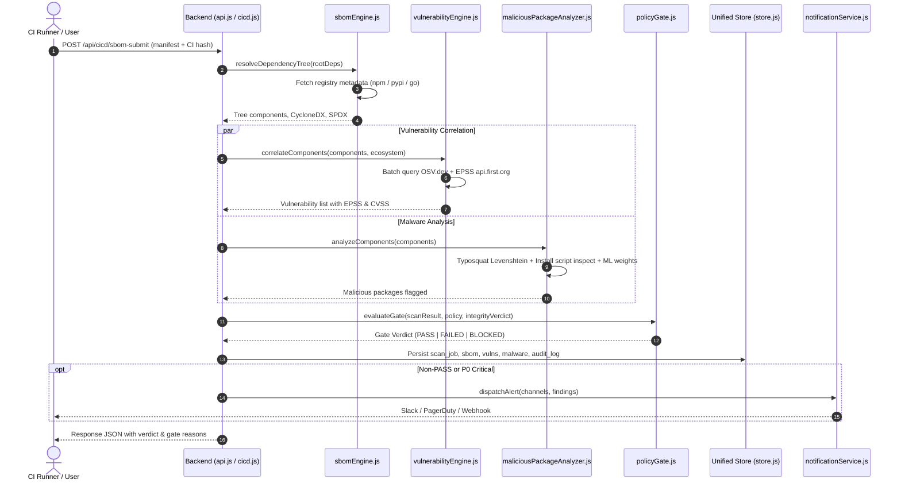

# SecureChain — Comprehensive AI Context & Architecture Extract

> **Purpose:** Ingestion digest for AI coding agents and LLMs to understand the complete codebase, data structures, module interactions, and system architecture of SecureChain.

---

## 1. System Identity & Mission
- **Name:** SecureChain
- **Domain:** Real-time Software Supply Chain Security Platform (SBOM, Vulnerability Management, Malware Detection, CI/CD Policy Enforcement).
- **Core Value Proposition:** Automated ingestion of dependency manifests (npm, PyPI, Go, Maven), transitive tree resolution, zero-day & known vulnerability correlation (OSV, EPSS, NVD), local offline ML & heuristic typosquat/malware detection, policy gating for CI/CD pipelines, and regulatory compliance mapping (SLSA L2+, NIST SSDF, OWASP SCVS).

---

## 2. Technology Stack

| Layer | Technologies | Details |
|---|---|---|
| **Backend Runtime** | Node.js (CommonJS, Express 5.2.1) | Port 4000, `backend/src/server.js` |
| **Realtime** | `ws` (8.21.0) | WebSocket stream at `/ws/threat-feed` |
| **Data Layer** | Dual Engine: `lowdb` (7.0.1) + `@supabase/supabase-js` (2.110.0) | Local JSON fallback (`securechain.db.json`) + cloud Supabase PostgreSQL |
| **Authentication** | JWT (`jsonwebtoken` 9.0.3), `bcryptjs` 3.0.3 | GitHub OAuth (`read:user, repo`), Google OAuth 2.0, Email/Password |
| **Intelligence** | Local ML (Logistic Regression, zero external deps), Google Gemini (`@google/genai` or direct REST), Anthropic Claude (`@anthropic-ai/sdk` 0.109.1) | Offline ML package scoring + LLM remediation advisor |
| **External Security APIs** | `api.osv.dev`, `api.first.org/data/v1/epss`, `services.nvd.nist.gov` | Batch vulnerability queries & exploit probability scores |
| **Frontend** | React 19.2.7, Vite 8.1.1, TailwindCSS 4.3.2, React Router 7.18.1 | Port 5173, Single Page Application |
| **UI & Visuals** | Lucide React, Framer Motion 12.4.21, Recharts 3.9.1, HTML5 Canvas | Animated Dependency Graph, Laser Block Scanner, Live Threat Ticker |
| **Infrastructure** | Docker Compose, Nginx Reverse Proxy | Production container setup (ports 80/443 -> 4000/5173) |

---

## 3. Directory Layout

```
securechain/
├── docker-compose.yml          # Nginx, backend, frontend composition
├── nginx.conf                  # Reverse proxy rules (/api/* -> backend, / -> frontend)
├── backend/
│   ├── package.json
│   ├── Dockerfile
│   ├── src/
│   │   ├── server.js           # Express app & WebSocket server entrypoint
│   │   ├── middleware/
│   │   │   └── auth.js         # JWT bearer verification (requireAuth)
│   │   ├── db/
│   │   │   ├── store.js        # Unified store wrapper (lowdb + Supabase sync)
│   │   │   ├── supabaseStore.js# Supabase schema SQL & table definitions
│   │   │   └── securechain.db.json # Local persistent datastore (1.5MB)
│   │   ├── modules/
│   │   │   ├── sbomEngine.js   # Transitive dependency resolver (npm/yarn)
│   │   │   ├── ecosystemResolvers.js # PyPI, Go Proxy, Maven resolvers
│   │   │   ├── vulnerabilityEngine.js # OSV.dev, EPSS, and NVD correlation
│   │   │   ├── maliciousPackageAnalyzer.js # Heuristics, scripts, typosquatting
│   │   │   ├── mlClassifier.js # Offline Logistic Regression classifier & weights
│   │   │   ├── policyGate.js   # Decision engine: PASS / FAILED / BLOCKED
│   │   │   ├── buildIntegrity.js # CI config hash baseline verification
│   │   │   ├── complianceEngine.js # SLSA, NIST SSDF, OWASP compliance generator
│   │   │   ├── notificationService.js # Slack, Jira, PagerDuty, SMTP dispatcher
│   │   │   ├── adminLayer.js   # Orgs, roles, API keys, audit logging
│   │   │   ├── aiThreatEngine.js # Gemini/Claude conversational remediation
│   │   │   ├── threatFeed.js   # Background emitter for WebSocket feed
│   │   │   ├── githubAuth.js   # GitHub OAuth code exchange & manifest fetching
│   │   │   ├── googleAuth.js   # Google OAuth code exchange
│   │   │   └── webhookSecurity.js # HMAC-SHA256 signature verification
│   │   └── routes/
│   │       ├── api.js          # Core routes (auth, repos, manifests, scans, sbom)
│   │       ├── cicd.js         # CI/CD CLI plugin endpoint & webhooks
│   │       ├── admin.js        # Admin orgs, users, API keys, compliance download
│   │       ├── ai.js           # AI chat & remediation endpoints
│   │       └── notifications.js# Alert dispatch config & test hooks
└── frontend/
    ├── package.json
    ├── vite.config.js
    └── src/
        ├── App.jsx             # React Router routing definition
        ├── main.jsx            # React root mount
        ├── index.css           # Global Tailwind tokens & styling
        ├── lib/
        │   └── api.js          # Centralized fetch client (Bearer auth injection)
        ├── hooks/
        │   ├── useAuth.jsx     # Auth state context & user profile
        │   └── useThreatFeed.jsx # WebSocket hook for threat ticker
        ├── components/
        │   ├── DashboardLayout.jsx # Authenticated sidebar + topbar shell
        │   ├── Sidebar.jsx     # Navigation links & active state
        │   ├── AiChatbot.jsx   # Slide-out interactive security consultant
        │   ├── ThreatFeedTicker.jsx # Header live-feed animation
        │   ├── LaserBlockScanner.jsx# HTML5 Canvas laser dependency scanning
        │   ├── DependencyGraphPulse.jsx # Canvas visualizer for dependency nodes
        │   └── OnboardingModal.jsx # New user quickstart wizard
        └── pages/
            ├── Landing.jsx     # High-aesthetic dark marketing homepage
            ├── Auth.jsx        # Login, Register, OAuth callback receivers
            ├── Overview.jsx    # Dashboard metrics, risk scores, charts
            ├── Repositories.jsx# Repository connection, GitHub sync, manifest upload
            ├── Sbom.jsx        # CycloneDX & SPDX component viewer & exporter
            ├── Vulnerabilities.jsx # CVE/GHSA tracker with EPSS filters
            └── OtherPages.jsx  # Malware, CI/CD, Alerts, Compliance, Admin tabs
```

---

## 4. End-to-End Pipeline Execution Flow



---

## 5. Datastore Schema (Tables & Collections)

The datastore maintains dual consistency between local `securechain.db.json` and Supabase:
1. **`users`**: `{ id, githubId, googleId, login, email, passwordHash, avatar, name, role, provider, githubAccessToken, createdAt }`
2. **`organisations`**: `{ id, name, slug, ownerId, plan: 'free'|'team'|'enterprise', seats, createdAt }`
3. **`repositories`**: `{ id, fullName, defaultBranch, ownerId, riskScore, lastScanId, ciApiKey, policy, alertChannels, createdAt }`
4. **`scan_jobs`**: `{ id, repoId, source: 'MANUAL_UPLOAD'|'GITHUB_REPO'|'CI_PLUGIN'|'GITHUB_ACTIONS_WEBHOOK', status, startedAt, durationMs, gateVerdict, componentCount }`
5. **`sboms`**: `{ id, repoId, scanJobId, components: [...], cycloneDX: {...}, spdx: {...}, createdAt }`
6. **`vulnerabilities`**: `{ id, repoId, scanJobId, id: 'CVE-...', component, version, severity, cvss, epss, priorityLabel, fixedIn, status: 'Open'|'Resolved' }`
7. **`malicious_packages`**: `{ id, repoId, scanJobId, name, version, confidence, riskLevel: 'CRITICAL'|'HIGH', reasons: [...], signals: {...} }`
8. **`alerts`**: `{ id, type, severity, target, channel, status, createdAt }`
9. **`compliance_reports`**: `{ id, repoId, generatedAt, frameworks: { slsa: {...}, ssdf: {...}, owasp: {...} }, score }`
10. **`api_keys`**: `{ id, name, keyHash, prefix, scopes: [...], ownerId, createdAt, lastUsedAt }`
11. **`audit_log`**: `{ id, timestamp, actor: { id, login }, action, target: { type, id }, meta: {...} }`

---

## 6. Security Analysis & Policy Rules

### Policy Gate Logic (`policyGate.js`)
- **`BLOCKED`**: Triggered if any package is identified as malicious (confidence ≥ 0.70) or CI build integrity baseline check fails (tampered workflow config).
- **`FAILED`**: Triggered if count of Critical/High CVEs exceeds configured repository thresholds (default: max 0 Critical, max 2 High) or if EPSS score > 0.60.
- **`PASS`**: All findings within tolerance.

### ML Malicious Classifier (`mlClassifier.js`)
- Logistic regression model running completely offline on extracted metadata features:
  - `min_dist_to_popular` (Levenshtein distance to top 50 packages)
  - `has_install_script` (preinstall, postinstall, install hooks)
  - `age_days` (time since release on registry)
  - `release_cadence_days`
  - `maintainer_count`
  - `has_repository_field`
  - `tarball_size_bytes`
  - `author_published_count`
- Calibrated weights: `model_weights_npm.json`, `model_weights_pypi.json`, `model_weights_go.json`, `model_weights_maven.json`.

---

## 7. Known Architectural Hotspots & Review Gaps

1. **Access Control (RBAC):** Admin endpoints in [`backend/src/routes/admin.js`](file:///e:/securechain/backend/src/routes/admin.js) require JWT authentication but lack role-checking (`req.user.role === 'Admin'`).
2. **Repository Authorization (IDOR):** [`GET /repos/:id`](file:///e:/securechain/backend/src/routes/api.js#L445) and [`POST /repos/:id/scan`](file:///e:/securechain/backend/src/routes/api.js#L476) do not verify that `repo.ownerId === req.user.sub`.
3. **Webhook Security:** [`backend/src/routes/cicd.js:137`](file:///e:/securechain/backend/src/routes/cicd.js#L137) bypasses signature validation if `GITHUB_WEBHOOK_SECRET` is unset in `.env`.
4. **Cloud Persistence:** [`backend/src/db/store.js:170`](file:///e:/securechain/backend/src/db/store.js#L170) only syncs `users` to Supabase. Other tables depend solely on local disk (`securechain.db.json`).
